# Sahety — E-Commerce App (Flutter + Firebase)

A complete mobile e-commerce application built with **Flutter** and backed by **Firebase** (Authentication, Cloud Firestore, Cloud Messaging) with product images on **Supabase Storage**. One app, two roles — the role is read from the server-side user profile after login and drives which UI the app boots into:

- **Customer** — bilingual (English/Arabic) catalog with search and category filters, product details, favorites, a Firestore-backed cart, cash-on-delivery checkout, order tracking, and push notifications.
- **Admin** — dashboard for product management (bilingual fields + image upload) and order fulfillment through a status lifecycle.

Firestore Security Rules enforce the roles server-side — a regular user cannot promote themselves to admin.

## Screens

Captured on a Pixel 7 Pro emulator running in [demo mode](#demo-mode-local-emulator) against seeded dummy data.

**Customer app**

| Login | Home | Products | Product details |
| --- | --- | --- | --- |
| 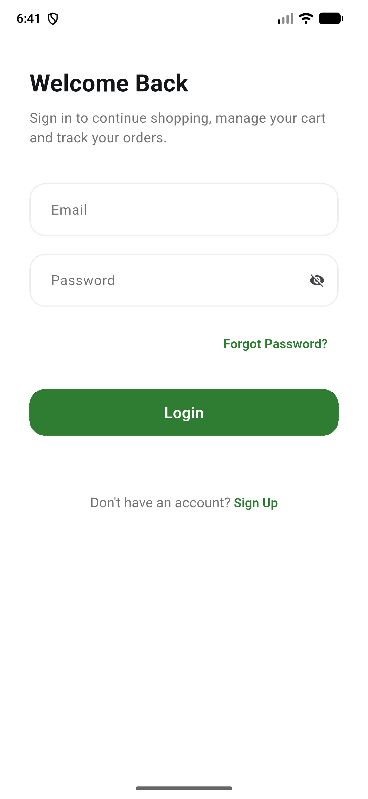 | 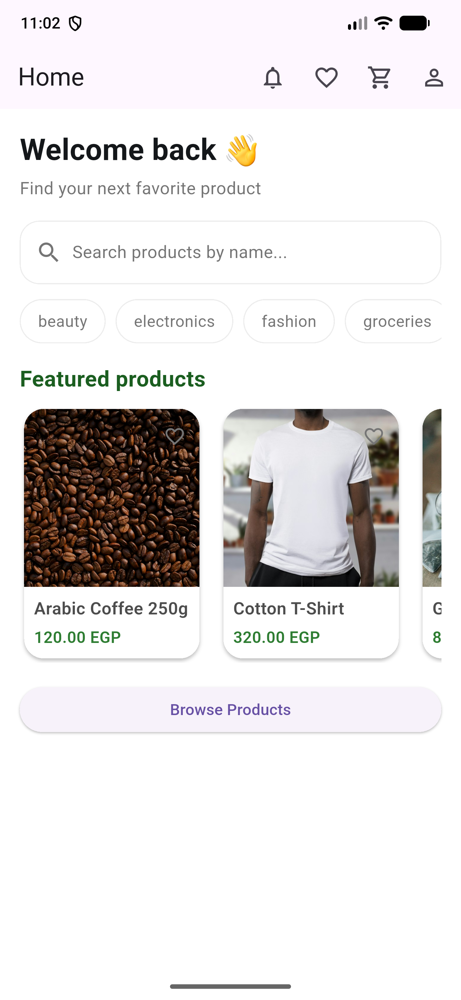 | 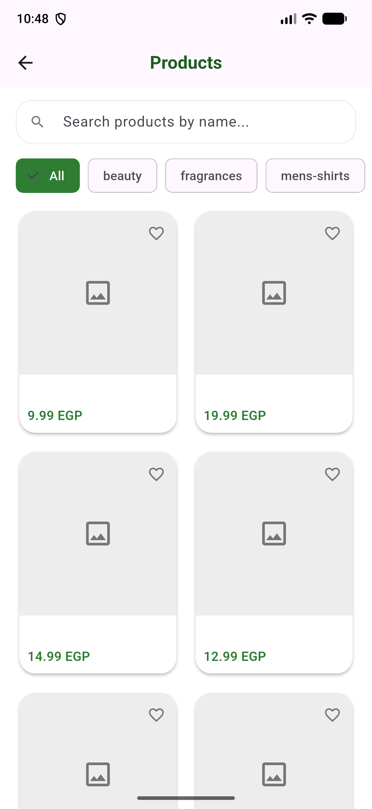 | 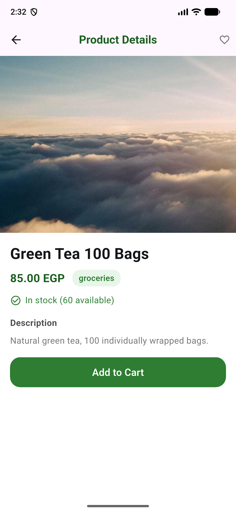 |

| Favorites | Cart | Checkout (cash on delivery) | Order success |
| --- | --- | --- | --- |
| 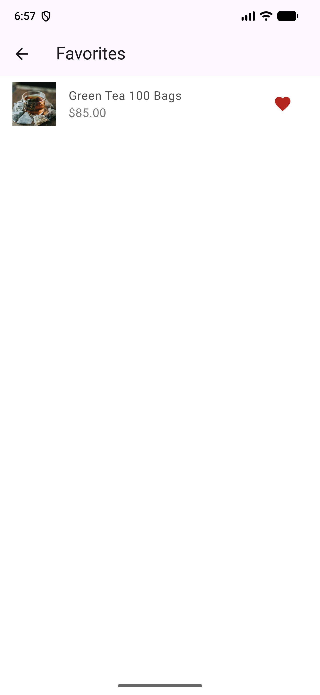 | 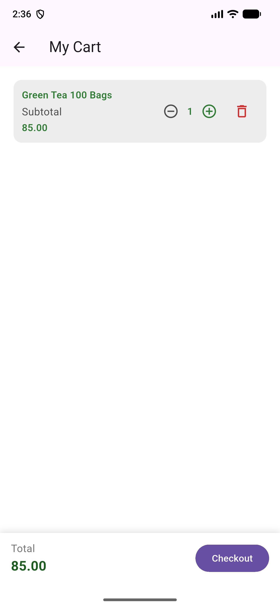 | 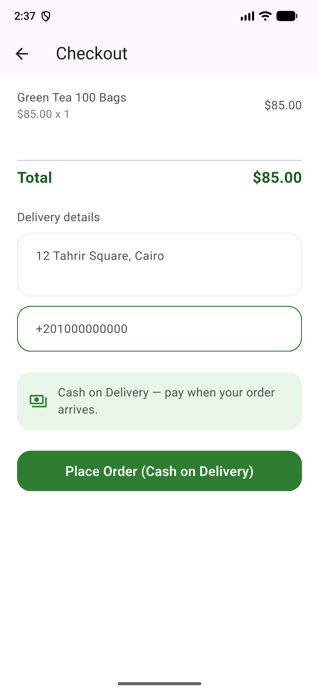 | 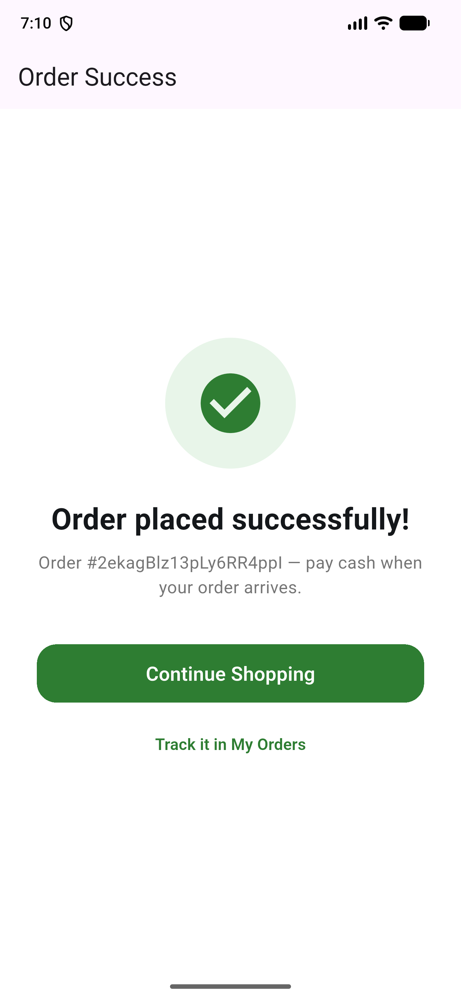 |

| My Orders | Order details | Notifications |
| --- | --- | --- |
| 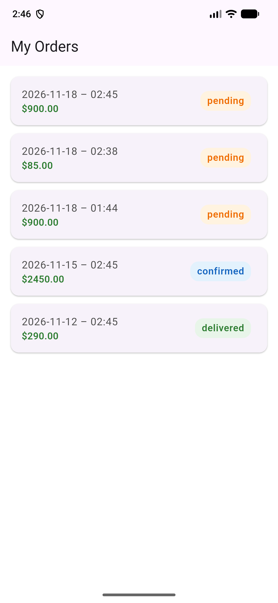 | 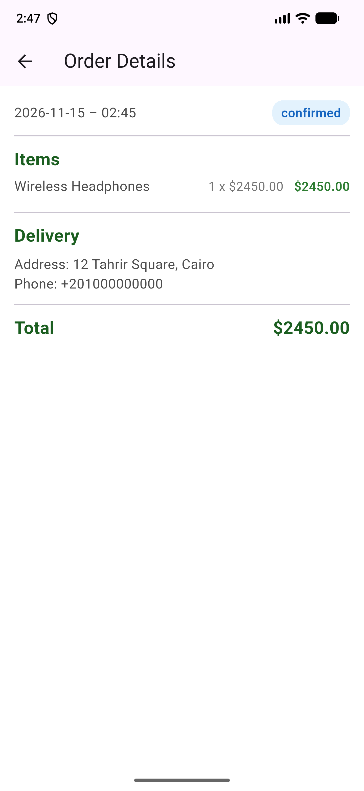 | 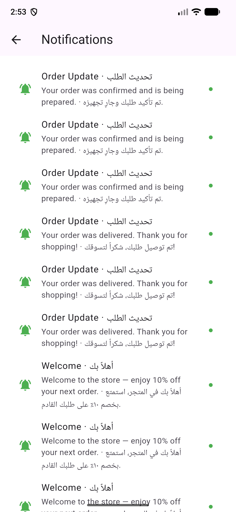 |

**Admin app**

| Dashboard | Product management | Product form (EN/AR) | Incoming orders |
| --- | --- | --- | --- |
| 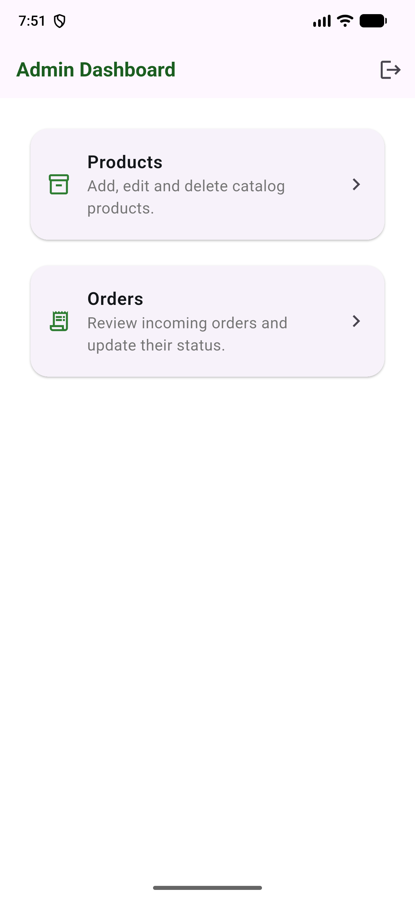 | 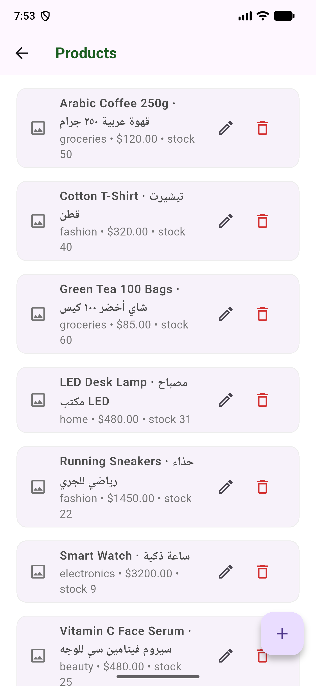 | 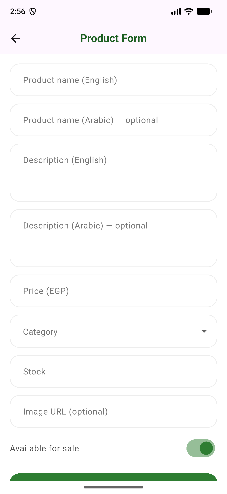 | 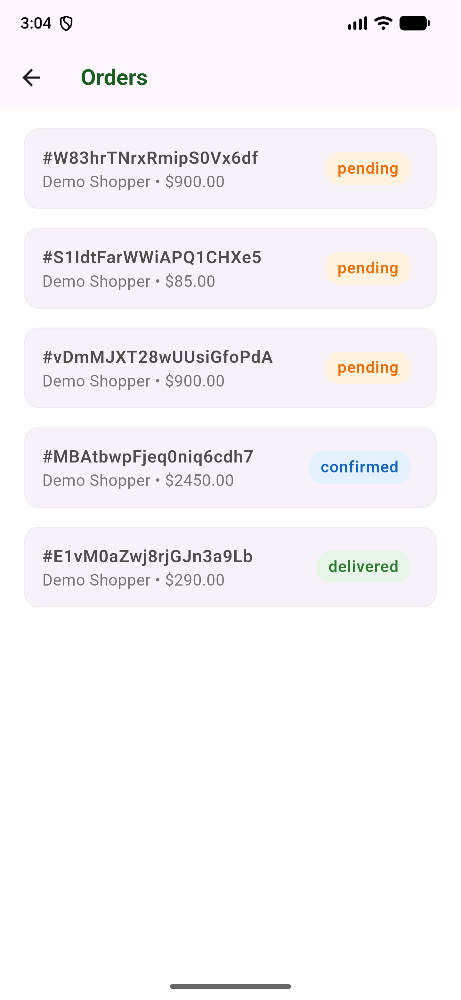 |

| Order review + status flow |
| --- |
| 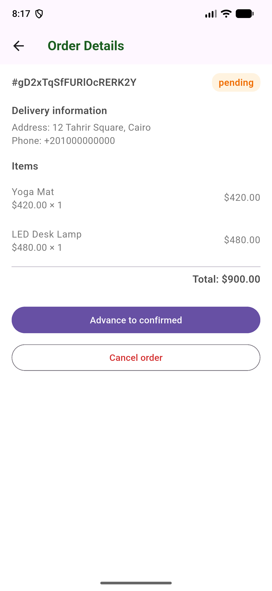 |

## Features

**Customer**
- **Authentication** — register, login, forgot password, and a profile with name, phone, and delivery address.
- **Catalog** — product cards with images; live search matches the English *and* the Arabic product name; category filtering composes with the search query.
- **Favorites** — add/remove products, persisted per user in Firestore.
- **Cart** — quantity controls, remove item, per-item subtotals and total; stored in Firestore so it survives app restarts.
- **Checkout** — delivery address + phone, **cash on delivery**; stock is validated and the order total is recomputed by Firestore rules before the order is created.
- **My Orders** — order history with live status (pending → confirmed → preparing → shipped → delivered).
- **Notifications** — FCM token registration, push on order-status changes, an in-app notification center, and tapping a notification opens the order.

**Admin**
- **Product management** — create, edit, and delete products with optional Arabic name/description and image upload to Supabase Storage.
- **Order management** — incoming orders list, order review (items, quantities, delivery info), and status updates along the lifecycle; cancellation is allowed only while the order is still pending.

## Tech stack

| Layer | Choice |
| --- | --- |
| Framework | Flutter (Android-first) |
| Auth | Firebase Authentication (email/password) |
| Database | Cloud Firestore + Security Rules |
| Push notifications | Firebase Cloud Messaging (FCM) |
| Product images | Supabase Storage + `image_picker` |
| State management | `flutter_bloc` (Cubits) with freezed states |
| DI | `get_it` |
| Localization | `flutter_localizations` — `en` + `ar`, RTL mirroring |
| UI sizing | `flutter_screenutil` (375×812 design size) |
| Codegen | `build_runner` (freezed, json_serializable) |
| Testing | `flutter_test`, `mocktail`, `bloc_test`, Firebase fakes |

## Architecture

Feature-first layout — each feature owns its `data/` (repos, models), `logic/` (Cubit + freezed state), and `ui/` (screens, widgets):

```
lib/
├── core/                 # constants, DI (get_it), routing, theming, shared models & repos
├── features/
│   ├── admin/            # dashboard, product CRUD, order lifecycle
│   ├── auth/             # login, register, forgot password, profile
│   ├── cart/             # Firestore-backed cart
│   ├── catalog/          # home screen (customer shell)
│   ├── checkout/         # cash-on-delivery checkout + order success
│   ├── favorites/
│   ├── notifications/    # FCM service + in-app notification center
│   ├── orders/           # my orders + order details
│   └── products/         # products listing (search/filter) + details
└── ...
```

Repositories use the Firebase SDK directly (no HTTP layer); navigation and dialog wiring goes through dedicated `*_bloc_listener.dart` widgets, never inline in form callbacks.

## Data model

| Path | Used for |
| --- | --- |
| `users/{uid}` | profile (name, phone, address, **role**), FCM token |
| `users/{uid}/cart/{productId}` | cart lines |
| `users/{uid}/favorites/{productId}` | favorites |
| `products/{productId}` | catalog (price, stock, image URL, category + Arabic variants `nameAr` / `descriptionAr`) |
| `orders/{orderId}` | items (prices snapshotted at purchase), total, address, status |
| `notifications/{id}` | in-app notification center records |

## Security

`firestore.rules` is the source of truth — admin actions are enforced server-side, not just hidden behind UI:

- Registration always creates `role: 'customer'`, and the rules reject any role change — nobody can self-promote to admin.
- Order creation is validated inside the rules: the caller's own `userId`, `status == 'pending'`, and a **total recomputed from live product prices** — the client-supplied total is never trusted.
- Users can read/write only their own profile, cart, favorites, and orders; product and notification writes are admin-only.

## Getting started

```bash
flutter pub get
flutter run
```

The repo ships committed Firebase config for project `sahety-ba784` (`lib/firebase_options.dart`, `android/app/google-services.json`), so it builds out of the box. To use your own project: create it, enable Email/Password auth + Cloud Firestore, add an Android app with package name `com.example.e_commerce_app`, drop its `google-services.json` into `android/app/`, and deploy the rules with `firebase deploy --only firestore:rules`.

To create an admin: register a normal account first, then set `role: 'admin'` on its `users/{uid}` document from the Firebase console (the rules block self-promotion, so there is no in-app flow).

## Demo mode (local emulator)

Run the entire app against a **local Firestore emulator seeded with dummy data** — self-contained and never touches the live database:

```bash
# 1. start the local Firestore emulator (needs JDK 21+)
npx firebase emulators:start --project sahety-ba784 --only firestore --config=.demo-firebase.json

# 2. seed dummy data (10 bilingual products with matching photos, orders in
#    mixed statuses, notifications)
node scripts/.demo-seed-emulator.mjs

# 3. build + install the app in demo mode
flutter build apk --debug --dart-define=DEMO_EMULATOR=true
adb install -r build/app/outputs/flutter-apk/app-debug.apk
```

Demo credentials (demo-only accounts — never reuse these passwords anywhere real):

| Role | Email | Password |
| --- | --- | --- |
| Admin | `admin@sahety.app` | `Admin@123456` |
| Customer | `demo.shopper@shop.test` | `Demo@1234` |

## Testing

```bash
flutter test                                # unit + widget tests (265 passing)
flutter test integration_test -d <device>   # integration tests on a device/emulator
```

## Ops scripts

`scripts/` (see `scripts/README.md`) holds a Node.js toolkit for the live project: `npm run seed` (30 bilingual demo products with generated images uploaded to Supabase), `npm run watch` (order status change → FCM push + in-app notification via the Admin SDK), and `npm run reset`.

## Notes

- Notifications are *received* by the app; *sending* them on status changes comes from a trusted Admin SDK environment (`scripts/watch-orders.mjs`), never the Flutter client — the rules only allow admins to create notification documents.
- `dependency_overrides` in `pubspec.yaml` (`test: 1.31.1`, `analyzer >=14 <15`) resolve a bloc_test ↔ freezed analyzer clash — do not remove them.
